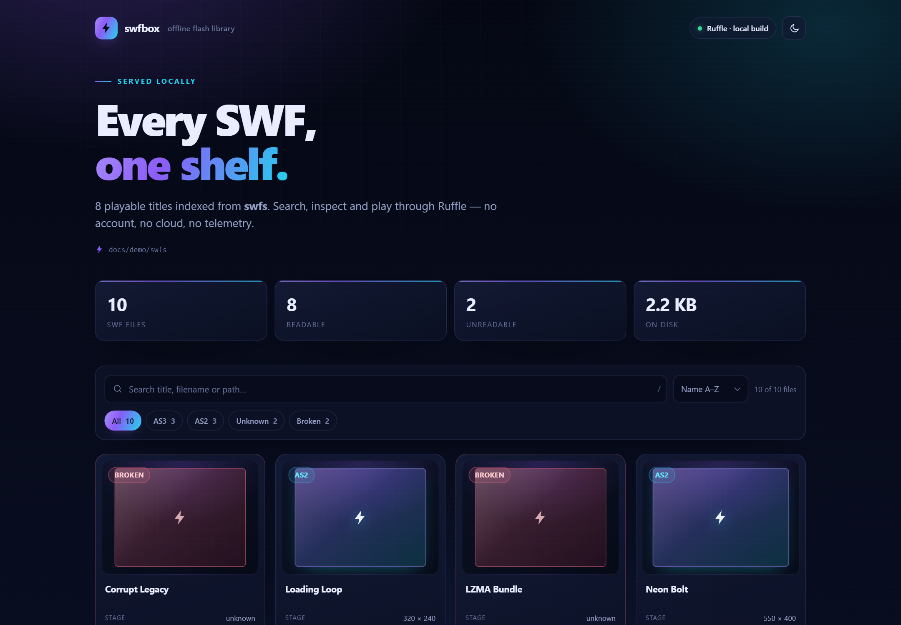
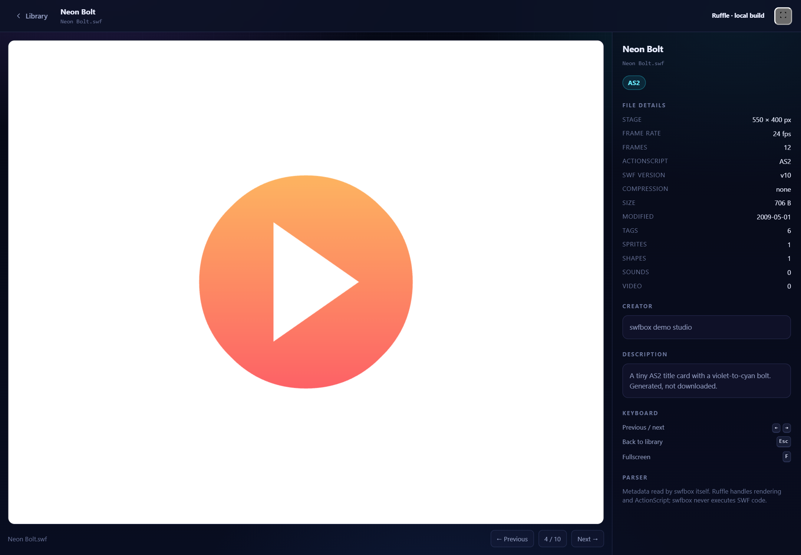
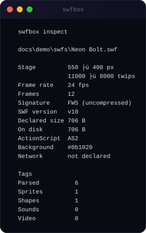

# swfbox

**Your offline Flash library.** Point it at a folder of `.swf` files — browse, inspect and play them through [Ruffle](https://github.com/ruffle-rs/ruffle).

[](https://github.com/arifs122/swfbox/actions/workflows/ci.yml)
[](https://www.npmjs.com/package/swfbox)
[](LICENSE)
[](https://nodejs.org)

`swfbox` reads SWF metadata itself (zero dependencies), builds a searchable offline index, and launches any file in Ruffle. It is a library and launcher, not an emulator.

```
$ npx swfbox ~/old-flash
Scanning /home/you/old-flash …
  312 files · 307 readable · 5 broken · 148.2 MB
  AS3 184 · AS2 96 · unknown 27
  ✓ Wrote swfbox-library.html
  Ruffle: not configured — run swfbox --fetch-ruffle for playback
```

## What this is / what this is not

**What this is**

- A **library and launcher** for folders of old `.swf` files.
- A **real SWF metadata parser**: header, stage rectangle, frame rate, frame count, tag stream, ActionScript generation, background colour, embedded XMP.
- A **single-file static index** you can open without a server, plus a **local server** with a focused player page.
- A **thin, honest Ruffle integration**: `swfbox` finds or downloads a Ruffle build, serves it, and points `<ruffle-player>` at your file. Ruffle does the rendering, ActionScript, audio and input.

**What this is not**

- **Not a Flash emulator.** Flash cannot be reimplemented in a weekend and does not need to be: **[Ruffle](https://github.com/ruffle-rs/ruffle) is the emulator** (approximately 18.7k GitHub stars, MIT OR Apache-2.0). `swfbox` would be useless without it.
- **Not a renderer.** There are no frame thumbnails. Cards use a CSS stage placeholder sized by the SWF's real aspect ratio.
- **Not an ActionScript runtime.** It never executes SWF code.
- **Not a converter, decompiler or editor.**
- **Not a replacement for Ruffle.** It is the shelf in front of the player.

## Why

Old Flash archives are painful for boring reasons:

- The files are named `movie_final_v3.swf`, `intro(1).swf`, `untitled.swf`.
- Dimensions, frame rate, frame count and ActionScript version are buried in a binary format.
- Opening `swfbox-library.html` from `file://` is fine for the index, but browsers refuse to `fetch()` sibling SWFs from `file://`, so playback needs a local server.
- Ruffle is excellent at playing a single SWF, but it is a player, not a library. It does not scan a folder, build an index, or tell you which file is the AS3 one.
- Existing SWF libraries read bytes; existing runtimes run bytes. Neither is a library/launcher.

`swfbox` fills that gap: scan once, get a searchable shelf, play through the emulator that already exists.

## Requirements

- Node.js **18 or newer** (Node 20/22 recommended).
- No runtime dependencies. `dependencies` and `devDependencies` are intentionally empty.
- A modern browser to use the player (Ruffle is a web component).
- Optional: a Ruffle build if you want playback offline.

## Quick start

```bash
# Scan and build a static library page in the current directory
npx swfbox ~/old-flash

# Open the page
open swfbox-library.html        # macOS
xdg-open swfbox-library.html    # Linux
start "" swfbox-library.html    # Windows

# Serve the same library with a working player
npx swfbox serve ~/old-flash --open

# Or play one file directly
npx swfbox play ~/old-flash/intro.swf
```

From a checkout:

```bash
npm test
node bin/swfbox.js docs/demo/swfs -o library.html
node bin/swfbox.js serve docs/demo/swfs --open
```

A plain scan gives you the index and the metadata immediately. To make the play buttons work from a static page, vendor Ruffle once (into the scanned folder) or serve the library:

```bash
npx swfbox --fetch-ruffle ~/old-flash   # one-time download, then exits
npx swfbox ~/old-flash                  # now uses .swfbox/ruffle
# or, without downloading:
npx swfbox serve ~/old-flash --open
```

## The three modes

### 1. Static library

```bash
swfbox [dir] -o swfbox-library.html
```

Walks the folder recursively, parses every `.swf`, and writes one self-contained HTML file. Search, filter chips (All / AS3 / AS2 / Unknown / Broken), sorting (name, size, frames, modified), a result count, responsive cards and a modal player.

The page has no external stylesheets, fonts, analytics or scripts. If no Ruffle build is configured, clicking a card explains exactly how to enable playback instead of failing silently. If `--ruffle` or a vendored build is configured, the modal loads `<ruffle-player>` lazily.

Static pages opened over `file://` may be blocked from reading sibling SWFs by the browser's security model. The page says so. Use `swfbox serve` for guaranteed playback.

### 2. Local server and player

```bash
swfbox serve [dir] --port 8080
```

Serves:

| Route | What it is |
| --- | --- |
| `/` | the live library page |
| `/player?f=<path>` | full-bleed Ruffle stage, metadata sidebar, previous/next |
| `/swf/<path>` | the SWF bytes with `application/x-shockwave-flash` |
| `/ruffle/*` | the vendored Ruffle build, when present |
| `/health` | JSON health/counts for scripts and tests |

The server binds to `127.0.0.1`, auto-increments the port when it is busy, and only serves SWFs that are in the scanned index. Player keyboard shortcuts: `←` / `→` for previous/next, `Esc` to return to the library, `F` for fullscreen.

### 3. Inspect

```bash
swfbox inspect <file.swf>
swfbox inspect <file.swf> --format json
```

Prints the parsed metadata as a readable terminal report or deterministic JSON with sorted keys. Broken files are explained, not hidden. `inspect` exits `1` for an unreadable file.

```json
{
  "backgroundColor": "#0b1020",
  "compression": "none",
  "error": null,
  "frameCount": 12,
  "frameRate": 24,
  "height": 400,
  "metadata": {
    "creator": "swfbox demo studio",
    "description": "A tiny AS2 title card.",
    "title": "Neon Bolt"
  },
  "signature": "FWS",
  "width": 550
}
```

## Options

```
swfbox [dir]                     scan a folder and write swfbox-library.html
swfbox serve [dir]               serve the library + player locally
swfbox play <file.swf>           serve and open one file
swfbox inspect <file.swf>        print the parsed metadata
swfbox --fetch-ruffle [dir]      download Ruffle into <dir>/.swfbox/ruffle, then exit
```

| Option | Description | Default |
| --- | --- | --- |
| `-o, --output <path>` | output file for `html`, `json` or `text` scans | `swfbox-library.html` |
| `-f, --format <fmt>` | `html`, `json` or `text` | `html` (`text` for `inspect`) |
| `--json` | shorthand for `--format json` | off |
| `--ruffle <path\|url>` | local Ruffle folder, `ruffle.js`, or a custom URL | auto-detect, then CDN in `serve` |
| `--fetch-ruffle` | download the pinned Ruffle web build into `.swfbox/ruffle` | off |
| `--port <n>` | server port; auto-increments when busy | `8080` |
| `--max-files <n>` | stop after this many SWFs and warn | `5000` |
| `--follow` | follow directory symlinks (loop-safe) | off |
| `--open` | open the browser for `serve`, `play` or an HTML report | off |
| `--theme <name>` | `dark` or `light` for generated pages | `dark` |
| `-q, --quiet` | fewer messages | off |
| `--no-color` | disable ANSI colour | auto |
| `-h, --help` | help | |
| `-v, --version` | version | |

Exit codes:

| Code | Meaning |
| --- | --- |
| `0` | success |
| `1` | no SWF files found, or invalid input |
| `2` | operational error (write, server, download) |

## Offline story

`swfbox` never touches the network by default. The only command that downloads anything is the explicit `--fetch-ruffle`.

| Setup | What loads Ruffle | Network |
| --- | --- | --- |
| `swfbox dir` (default) | nothing; the modal shows setup instructions | none |
| `swfbox dir --ruffle ./.swfbox/ruffle` | local `ruffle.js` (relative to the report) | none |
| `swfbox --fetch-ruffle dir` then `swfbox dir --ruffle .swfbox/ruffle` | local build | one-time download only |
| `swfbox serve dir` | pinned unpkg CDN **when you press play** | Ruffle from unpkg |
| `swfbox serve dir` after `--fetch-ruffle` | local build at `/ruffle/*` | none |
| `--ruffle https://example.com/ruffle.js` | your URL | your server |

### Ruffle resolution order

1. `--ruffle <path|url>` (explicit).
2. `<scanned-root>/.swfbox/ruffle/`.
3. `<home>/.swfbox/ruffle/`.
4. The pinned CDN build — **serve/play only**: `https://unpkg.com/@ruffle-rs/ruffle@0.7.1/ruffle.js`.

The UI always shows which Ruffle is in use. A static report with no configured build shows:

> No Ruffle configured — run `swfbox --fetch-ruffle` or `swfbox serve`.

### What `--fetch-ruffle` downloads

It fetches the npm tarball `@ruffle-rs/ruffle@0.7.1` from `registry.npmjs.org`, verifies the archive, and unpacks `ruffle.js`, the `.wasm` builds, source maps and licence files into `<dir>/.swfbox/ruffle/`. The download is capped at 60 MB, is gzip/tar validated, rejects path traversal, and prints progress. It is a one-time setup step; the resulting folder is ignored by git.

Ruffle is licensed **MIT OR Apache-2.0**. `swfbox` does not modify Ruffle. If the download fails, the error includes the manual alternative: download a release from [github.com/ruffle-rs/ruffle/releases](https://github.com/ruffle-rs/ruffle/releases), unzip it, and pass `--ruffle <folder>`.

## Metadata parsed

`src/swf.js` is a defensive, zero-dependency reader. It handles `FWS` (uncompressed), `CWS` (zlib) and recognises `ZWS` (LZMA) without pretending to decompress it.

| Field | Source | Notes |
| --- | --- | --- |
| Signature / version / file length | SWF header | `FWS`, `CWS`, `ZWS` |
| Compression | signature | `none`, `zlib`, `lzma` |
| Stage width / height | `RECT` | bit-packed signed twips, converted to pixels (`twips / 20`, 2 decimals) |
| Frame rate | header | UI16 fixed 8.8, e.g. `0x1800` → 24 fps |
| Frame count | header | UI16 |
| ActionScript version | `FileAttributes`, `DoABC`, `DoAction`, `DoInitAction` | AS3 if DoABC or the AS3 flag; else AS2 if action tags; else unknown |
| Background colour | `SetBackgroundColor` (9) | `#rrggbb` |
| XMP title / creator / description | `Metadata` (77) | elements and `rdf:Description` attributes, entities decoded |
| Has metadata | `Metadata` tag or `FileAttributes` flag | boolean |
| Use network | `FileAttributes` (69) | bit 0, advisory only |
| Tag count | tag stream | top-level tags, excluding `End` |
| Sprites | `DefineSprite` (39) | count |
| Shapes | `DefineShape` 2 / 22 / 32 / 83 | count |
| Sounds | `DefineSound` (14) | count |
| Video | `DefineVideoStream` (60) | count |
| Truncation | header and tag bounds | true when the declared file or a tag extends past the data |

Safety limits: 4 MB read per file during scans, 16 MB decompressed cap for `CWS`, 5000 top-level tags, 16 MB per tag. `ZWS` is reported as `compression: "lzma"` with null geometry and a clear note rather than a crash. Nested tags inside `DefineSprite` are not walked; counts are top-level.

## Screenshots







## Demo

The repository includes a deterministic, generated archive:

- `docs/demo/scripts/make-demo-swfs.mjs` writes ten synthetic SWFs (AS2, AS3, FWS, CWS, ZWS, XMP, a corrupt file, varied dimensions).
- `docs/demo/swfs/` contains the generated files.
- `docs/demo/demo.html` is a real static library page for that folder.
- `docs/demo/cli.txt` is real CLI output for the same folder.

Regenerate with:

```bash
npm run demo
```

File mtimes and the report timestamp are pinned, so the output is reproducible.

## Security notes

- **`swfbox` never executes SWF bytecode.** Playback happens inside Ruffle in your browser. Treat old SWFs as untrusted content regardless; Ruffle is the sandbox boundary.
- **Path traversal guard.** Every URL path is percent-decoded, rejected if absolute or containing `..`/NUL, resolved, and checked against its root. `/swf/*` additionally requires the file to exist in the scanned index. `/ruffle/*` is confined to the Ruffle folder.
- **Local only.** The server binds to `127.0.0.1`, serves `GET`/`HEAD` only, and does not implement uploads, CORS, or directory listings.
- **Escaping.** Filenames and metadata are untrusted. Server-rendered HTML escapes text and attributes; client data is JSON-embedded with `<`, `>`, `&`, U+2028 and U+2029 escaped; the client builds cards with `textContent`.
- **Bounded parsing.** Decompression, tag counts and per-file reads are capped. Absurd lengths, corrupt zlib, truncated headers, 0-byte files and wrong signatures produce an error record, never a stack trace.
- **No telemetry, no analytics, no CDN references** in generated reports. The only network URL that can appear is the documented Ruffle build (when configured or when serving with the CDN fallback).

## Project structure

```
bin/swfbox.js             thin CLI wrapper
src/cli.js                argument parsing, commands, exit codes, help
src/swf.js                SWF header + tag parser
src/scan.js               recursive bounded folder scan
src/library.js            index model shared by HTML, server and text
src/render-html.js        self-contained static library page
src/player.js             focused player page (Ruffle embed, sidebar, next/prev)
src/serve.js              node:http library + player + SWF bytes
src/ruffle.js             resolve, download and unpack Ruffle
src/render-text.js        terminal inspect and summaries
src/util.js               bytes, dates, escaping, ANSI, stable JSON
src/index.js              public library API
test/                     node:test suites with synthetic SWFs
test-support/             synthetic SWF builder used by tests
docs/demo/                deterministic demo archive and generator
.github/workflows/ci.yml  Node 18/20/22, tests, self-containment check
```

## Prior art

Honest credit, because none of this exists in a vacuum:

| Project | What it does | Relationship |
| --- | --- | --- |
| [Ruffle](https://github.com/ruffle-rs/ruffle) (~18.7k stars) | The Flash emulator in Rust/WASM | **The player.** `swfbox` integrates it and credits it prominently. |
| [as3swf](https://github.com/claus/as3swf) (~524 stars) | Low-level SWF reading/writing in ActionScript | A parser library, not a folder library or launcher. |
| [pyswf](https://github.com/taletex/pyswf) (~163 stars) | Python SWF reader/writer | Same: reading primitives, no offline shelf. |
| [swf2js](https://github.com/ienaga/swf2js) (~661 stars) | A JavaScript SWF runtime | A runtime, not a library/launcher; different approach from Ruffle. |

`swfbox` is deliberately small: it does not try to out-parse these projects or out-render Ruffle. It connects a folder to a player and makes the archive legible.

## Contributing

Bug reports, broken-SWF samples (sanitised) and pull requests are welcome. Read [CONTRIBUTING.md](CONTRIBUTING.md) and the [Code of Conduct](CODE_OF_CONDUCT.md). Run `npm test` before opening a PR.

Security issues: see [SECURITY.md](SECURITY.md). Please do not attach real proprietary SWFs to public issues.

## License

[MIT](LICENSE) © 2026 arifs122.

Ruffle is a separate project, licensed MIT OR Apache-2.0. `swfbox` does not redistribute Ruffle in this repository; `--fetch-ruffle` downloads it from the npm registry at your explicit request.
